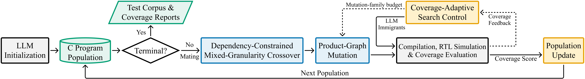
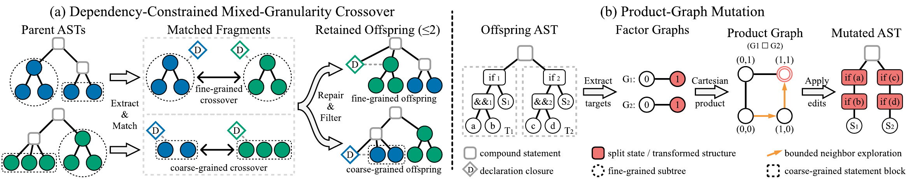

# SemEvoFuzz Core

This repository contains the core implementation of SemEvoFuzz, a
semantics-guided program-level evolutionary fuzzer for processor verification.

## Overview

<p align="center">
  
</p>

<p align="center"><em>SemEvoFuzz workflow from LLM initialization to coverage-guided population update.</em></p>

It contains the implementation of:

- dependency-constrained, mixed-granularity AST crossover;
- product-graph mutation with value and structural operators;
- coverage-adaptive operator scheduling;
- stagnation-triggered LLM immigration; and
- rank-based mating and population-update utilities.

<p align="center">
  
</p>

<p align="center"><em>Dependency-constrained mixed-granularity crossover and product-graph mutation.</em></p>

Compilation, processor execution, and coverage collection are connected through
a backend implementing the interface in `BACKEND_INTERFACE.md`.

## Setup

SemEvoFuzz currently targets Linux and Python 3.10 or later.
The parser build uses Git and a C compiler; source formatting uses `clang-format`.

```bash
python3 -m venv .venv
source .venv/bin/activate
pip install -r requirements.txt

cd Libs/tree_sitter
sh parser/build.sh
cd ../..
```

The parser build downloads the upstream `tree-sitter-c` grammar and creates
`Libs/tree_sitter/parser/my-languages.so`. The generated binary is ignored by
Git and should be rebuilt on the target machine.

## LLM configuration

Configure the LLM client in your launcher. `.env.example` lists the suggested
environment variables:

```bash
export OPENAI_API_KEY="..."
export OPENAI_BASE_URL="..."  # optional for an OpenAI-compatible endpoint
export OPENAI_MODEL="..."
```

Pass the initialized client and model name to the evolutionary driver.

## Backend integration

`semevofuzz_core.run_evolution` uses a backend for program initialization,
compilation, processor execution, coverage collection, and selected-population
persistence. `BACKEND_INTERFACE.md` defines the required return values and the
integration flow. Start an adapter from `examples/backend_skeleton.py`.

## Tests

From the repository root:

```bash
pytest
```

The included tests exercise dependency-constrained crossover, product-graph
mutation, and coverage-adaptive scheduling.

## License

The source code is released under the [MIT License](LICENSE).

